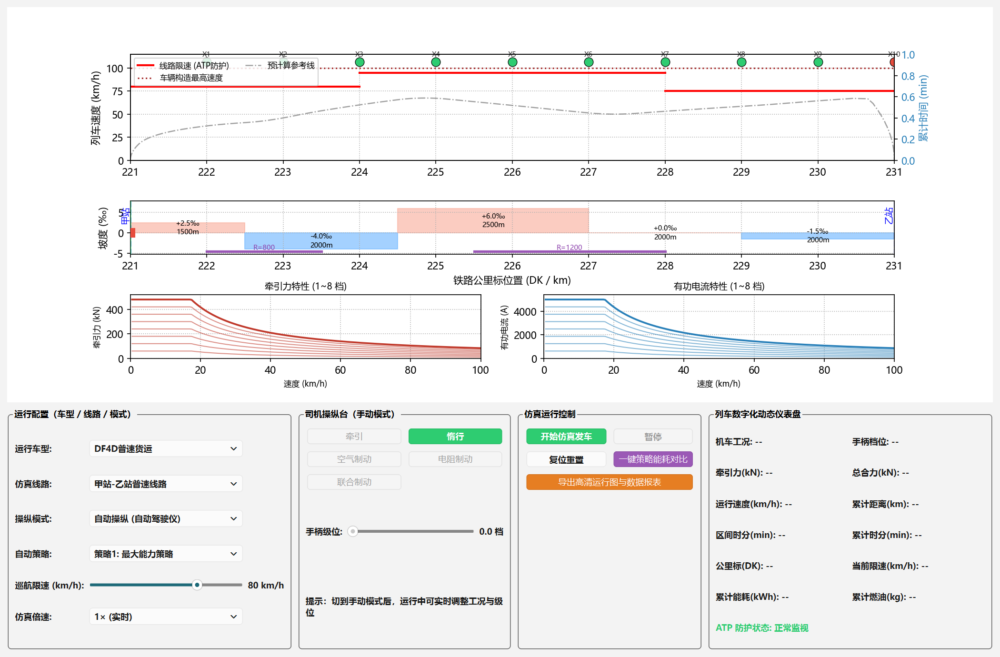
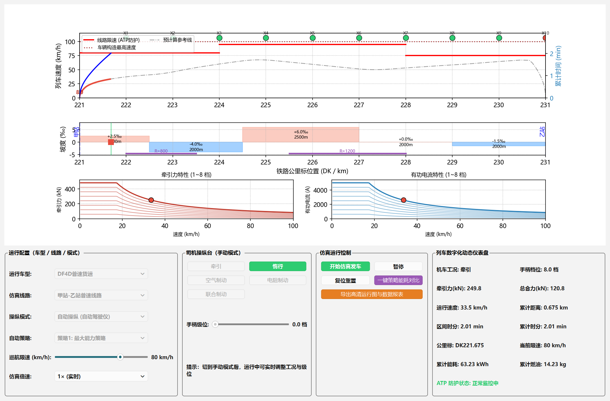
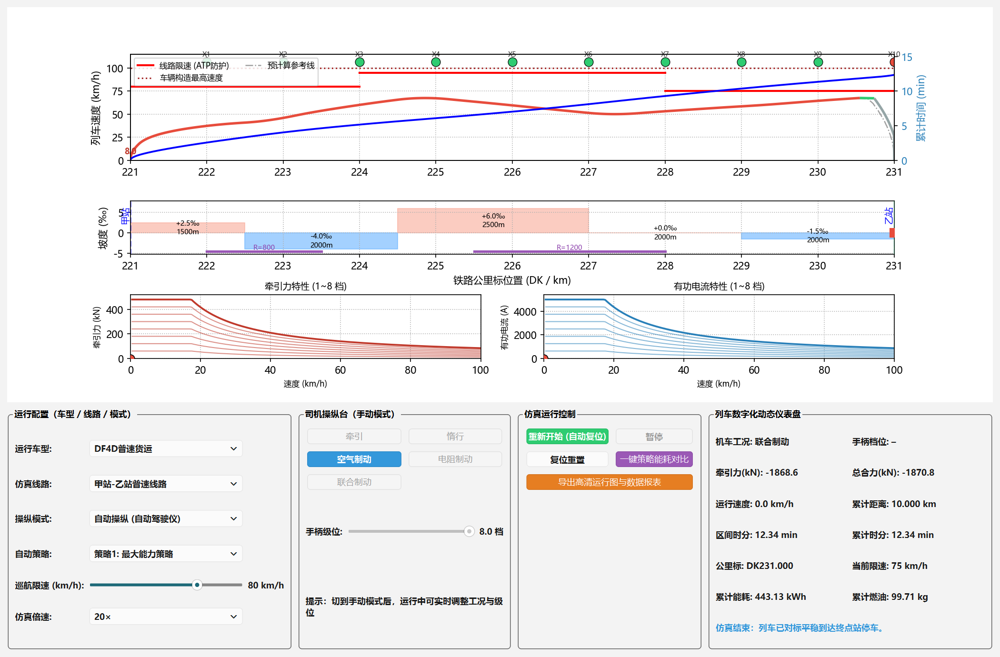
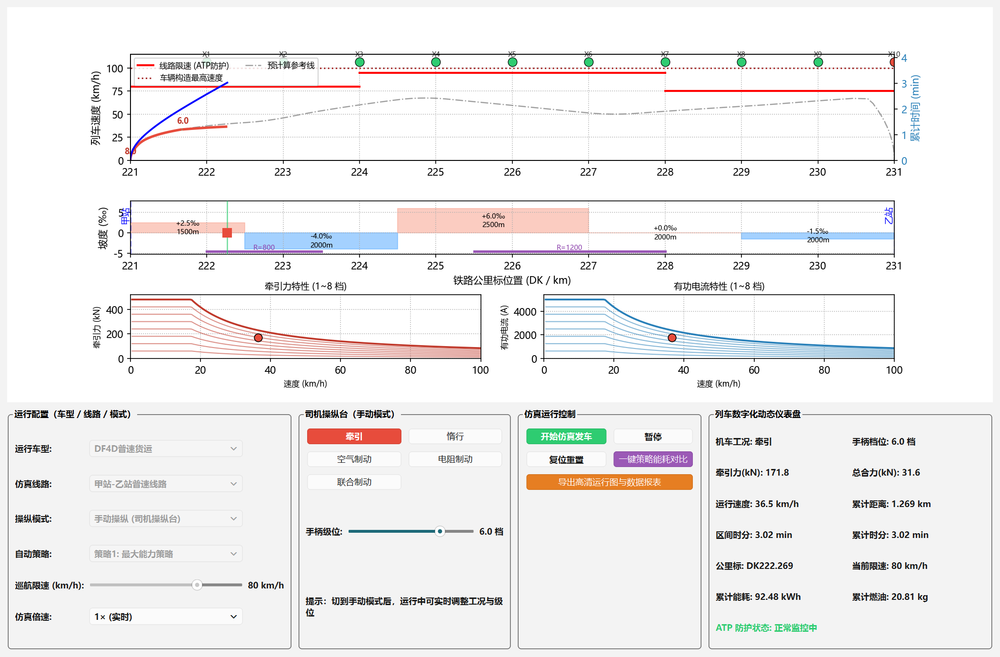
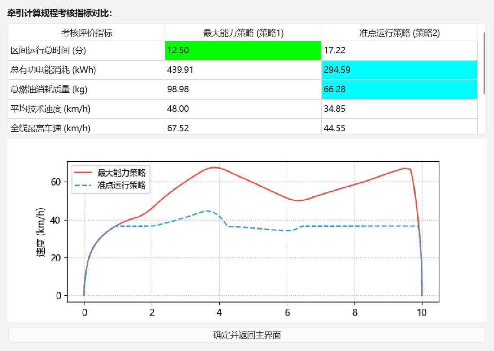

# DF4D 列车运行操纵模拟仿真系统

> **DF4D Train Operation Simulator** — A teaching simulation of train traction, braking and automatic driving based on China's *Railway Traction Calculation Regulations* (TB/T 1407).

**关键词 / Keywords：** 列车牵引计算 · 列车运行控制 · DF4D 内燃机车 · 自动驾驶 · ATP 超速防护 · traction calculation · train simulator


基于 **Python + PySide6 + Matplotlib** 开发的列车运行操纵教学模拟软件，严格遵循《列车牵引计算规程》(TB/T 1407) 的牵引力、阻力与制动计算体系。本项目为"列车运行控制技术"课程作业的持续完善版。



## 功能特性

### 运行图与可视化
- **主运行曲线图**：速度-距离曲线按五种工况自动着色（牵引红 / 惰行绿 / 空气制动蓝 / 电阻制动黄 / 联合制动灰），叠加蓝色时间-距离双 Y 轴曲线
- **线路限速红线**（ATP 防护底线）与**车辆构造最高速度**虚线
- **预计算参考线**：正式发车前后台预演全程，绘制灰色理论参考曲线，实际轨迹与参考线共用同一控制器，高度一致
- **铁路信号机**：按公里标绘制信号机，绿灯开放 / 红灯关闭，编号标注
- **档位标注**：仅在牵引工况级位变化点标注手柄档位数字
- **线路纵断面图**：坡道坡度(‰)与长度标注、曲线半径 R 标注、车站标注、公里标刻度，红色方块+绿色位置线实时显示列车位置
- **牵引力特性曲线 / 有功电流特性曲线**：1~8 档特性曲线族，红色圆点实时标记当前工作点

### 操纵与仿真
- **自动操纵**：
  - 策略 1：最大能力策略（全速发车）
  - 策略 2：准点节能策略（二分法寻找最优巡航速度）
  - 终点制动目标曲线对标停车、前方限速区段预判减速、下坡联合制动防超速
- **手动操纵（司机操纵台）**：牵引 / 惰行 / 空气制动 / 电阻制动 / 联合制动五种工况切换，0~8 档无级调速手柄，运行中可实时调整
- **仿真倍速**：1× / 10× / 20×
- **ATP 超速防护**：0.95 倍限速自动断电惰行预警，超速强制最大联合惩罚制动
- **坡道停滞监测**：牵引力不足以克服坡道阻力时给出警告，杜绝程序卡死
- **12 项实时参数仪表盘**：机车工况、手柄档位、牵引力、总合力、运行速度、累计距离、区间时分、累计时分、公里标、当前限速、累计能耗、累计燃油
- **一键策略能耗对比**：后台演算两种策略并弹出指标对比表（最优值自动着色）+ 双曲线对比图
- **一键导出**：300 DPI 高清运行图 + 全量历史离散点 CSV 数据报表

### 内置车型与线路
| 车型 | 总质量 | 功率 | 最高速度 |
|---|---|---|---|
| DF4D 普速货运 | 3138 t | 2320 kW | 100 km/h |
| 高速动车组 | 500 t | 8800 kW | 350 km/h |
| 重载货运列车（双机重联） | 10276 t | 4640 kW | 80 km/h（制动率降低 20%）|

内置 3 条教学线路：甲站-乙站普速线路（10 km）、长大下坡线路（15 km，连续 12‰ 下坡）、起伏坡道线路（20 km，8~9‰ 起伏坡道）。

## 安装与运行

```bash
# 1. 安装依赖（建议 Python 3.9+）
pip install -r requirements.txt

# 2. 运行程序
python main.py
```

## 自动化测试

物理引擎与自动驾驶的回归测试（制动距离、限速控制、停车精度、全车型×线路组合覆盖）：

```bash
python tests/test_simulation.py
```

全部通过时输出 `44 通过 / 0 失败`。

## 项目结构

```
train_control/
├── main.py             # 程序入口（配置中文字体后启动主应用）
├── main_window.py      # 主界面 UI：布局、信号绑定、绘图刷新
├── train_physics.py    # 牵引动力学核心：牵引力/阻力/制动力/运动方程 + ATP
├── train_types.py      # 车型参数与阻力/牵引/制动特性计算
├── route_infra.py      # 线路基础设施：坡道/曲线/限速/车站/信号机
├── auto_driver.py      # 自动操纵：双策略控制 + 参考曲线预演
├── plot_utils.py       # 绘图辅助：历史数据降采样、工况着色线段
├── font_config.py      # Windows 中文字体配置（Qt / Matplotlib）
├── tests/              # 自动化回归测试
└── docs/screenshots/   # 界面截图
```

## 核心算法

- **牵引力**：f_max(v) = min(起动/持续牵引力限制, 功率限制 3.6·P/v)，低速恒力矩、高速恒功率
- **基本阻力**：《牵规》综合经验公式 w0 = a + b·v + c·v² (N/kN)
- **附加阻力**：坡道附加 wi = i（考虑整列车长范围的加权平均坡道），曲线附加 wr = 600/R
- **制动力**：单位制动力(N/kN) × 全列重量 —— 空气制动(常用) 15、电阻制动 22、联合制动 60.7 N/kN，重载列车制动率折减 20%
- **运动方程**：dv/dt = (F − W) / (1000·(1+γ)·M)，前向欧拉积分，dt = 0.5 s

## 界面截图

| 自动运行中 | 全程完成对标停车 |
|---|---|
|  |  |

| 手动操纵（牵引 6 档）| 策略能耗对比 |
|---|---|
|  |  |

## 说明

- 本项目用于列车牵引计算教学与演示，牵引/制动参数为教学简化取值，不代表任何真实机车的完整性能
- 有功电流特性采用"电流与轮周牵引力成正比"的教学简化模型

## 许可证

[MIT](LICENSE) — 可自由学习、修改与分发，请注明出处。
